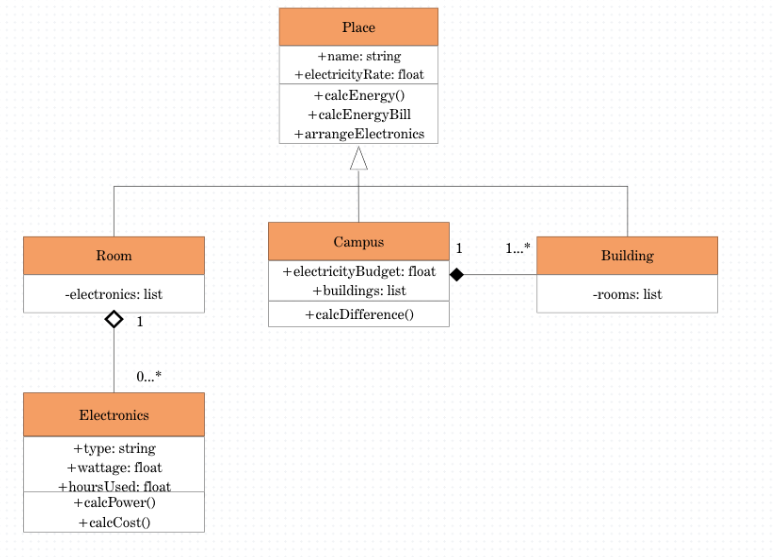

### Project Title or Name of the Application	: School Energy Consumption Tracker
### Section			   	      : 9-Beryllium
### Group Members			    : Pinlac, Torio, Veras
### Date (Proposal Date)  : Nov 13, 2026

### Project Description:

The Energy Consumption Tracker is a program which calculates the amount of energy used by a school according to data on the wattage of electronics and appliances used and the time frame. Using this same dataset, it also computes and displays useful information which gives more insights on the school’s energy consumption. Through this program, schools can effectively manage and tabulate their energy consumption and use information to locate and mitigate large consumers of energy, helping those institutions who have numerous appliances to take into account and/or those who face budget constraints. Furthermore, the information collected from this program can be used to make smart and evidence-based decisions for the school such as implementing new computers or laboratory equipment.

### Target:
This program is intended for public schools funded by the government to manage and control energy consumption. As these schools often face budget constraints, proper and timely management of expenses in this factor can be of great importance to being money efficient. While this program can be used in a lot of cases, it is most useful to schools that 1) have multiple assets to keep track of, or frequently receive new equipment, or 2) have a tight budget for a certain project.

### Classes:

1) Place
- The abstract class for all the specific places of the school.  
ATTRIBUTES  
    name: string, the name of the place  
    -electricityRate: float, the cost per kWh of the electricity of the place  
METHODS  
    calcEnergyBill(): returns the total cost of the electricity bill according to the individual consumption of each electronic  
    calcEnergy(): returns the total energy used in the specific place according to the individual consumption of each electronic  
    arrangeElectronics(): arranges the list of electronic devices according to their total energy consumption cost

2) Campus
- Inherits from Place class  
Composition relationship with Building class  
ATTRIBUTES  
    Attributes of Place class  
    electricityBudget: integer, allotted budget for electricity  
    buildings: list, the list of all the buildings in the campus  
METHODS  
    Methods of Place class  
    calcDifference(): calculates and returns the difference between the electricity budget and the calculated cost fo electricity 
		
3) Building
- Composition relationship with Room
- Inherits from Place class  
ATTRIBUTES  
    Attributes of Place class  
    rooms: list, the list of all the rooms in the building  
METHODS  
    Methods of Place Class

4) Room
- Aggregation relationship with Electronic
- Inherits from Place class  
ATTRIBUTES  
    Attributes of Place class  
    electronics: list, the list of all the electronics in the room  
METHODS  
    Methods of Place Class

5) Electronic
- Zero or more multiplicity with Room class  
ATTRIBUTES  
    type: string, type of the electronic (e.g. Light bulb, Refrigerator, Air conditioner)  
    wattage: float, the rate the electronic consumes energy  
    hoursUsed: float, the amount of hours the electronic is used  
METHODS  
    calcPower(): calculates the total energy used by multiplying the wattage in kilowatts and hours used then returns the value  
    calcCost(): calculates the cost of using the appliances for one day by multiplying the power by the electricity rate and returns the value.

Description  
Place serves as an abstract class which Campus, Building, and Room will inherit from. The program allows you to instantiate and edit existing campuses, buildings within campuses, and rooms within buildings. The list of electronics is found in the room class which is what will be accessed when retrieving the results in the campus and building level.

### Class Diagram:

### Goals:

In the long run, this program should lead to schools, specifically public schools, managing and lowering their total energy usage. By doing so, their funds would be used sensibly and they would be able to focus more on other causes to improve their school facilities.

Objective 1: Help institutions keep track of their energy expenditure  
Objective 2: Give a summary of the appliances that use the most energy  
Objective 3: Calculate the difference between the allotted budget for electricity and the program’s calculated bill.  
Objective 4: Help institutions who are on tight budgets make calculated decisions when it comes to their energy consumption.  
Objective 5: Foster environments that are more conscious of their energy consumption, helping them find ways to save more energy and be more efficient with their materials.